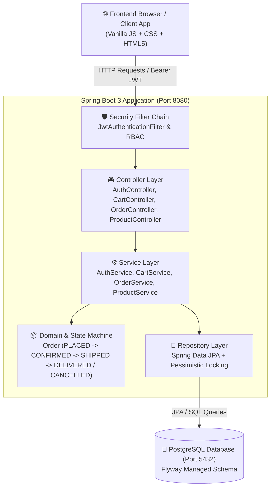
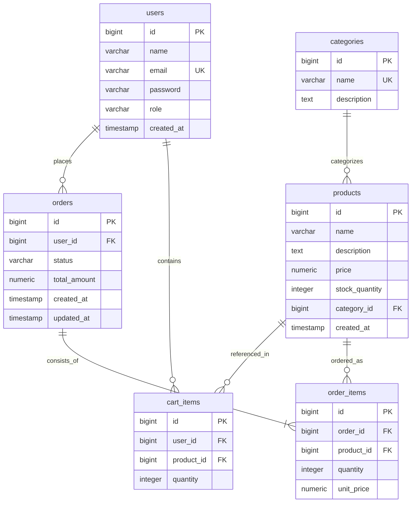

# 🛍️ ApexMart E-Commerce Order API & Storefront
## Complete Project Structure & Architecture Guide

---

## 1. 📂 Visual Directory Tree

```text
d:\JAVA\
├── .vscode/
│   └── settings.json                     # VS Code Java Language Server & JDK 17 environment configuration
│
└── ecommerce-order-api/
    ├── .mvn/
    │   ├── settings.xml                  # Local Maven repository configuration (D:/.m2/repository)
    │   └── wrapper/
    │       ├── MavenWrapperDownloader.java
    │       ├── maven-wrapper.jar
    │       └── maven-wrapper.properties
    │
    ├── docker-compose.yml                # PostgreSQL 16 Alpine database container configuration
    ├── mvnw, mvnw.cmd                    # Maven wrapper executable scripts (Unix & Windows)
    ├── pom.xml                           # Project build file (Spring Boot 3.2.5, Java 17, JWT, Flyway)
    ├── PROJECT_STRUCTURE.md              # Project structure reference & architectural documentation
    │
    └── src/
        ├── test/                         # Unit and integration test folder
        └── main/
            ├── resources/
            │   ├── application.properties# Database credentials, JPA settings, JWT secrets, Swagger config
            │   │
            │   ├── db/migration/         # Flyway Database Migration Scripts
            │   │   ├── V1__init.sql          # Base schemas: users, categories, products, cart_items, orders, order_items
            │   │   ├── V2__seed.sql          # Initial categories and baseline hardware products
            │   │   └── V3__more_products.sql # Extended lifestyle, office, and smart home catalog
            │   │
            │   └── static/               # Storefront & Admin Web Application (Single-Page App)
            │       ├── index.html            # Core SPA layout: Navbar, catalog, drawers, and modal dialogs
            │       ├── css/
            │       │   └── style.css         # Modern dark/light design system, glassmorphism, responsive grid
            │       ├── js/
            │       │   └── app.js            # State management, API clients, quick-commerce checkout, live tracking, admin console
            │       └── images/               # High-resolution local studio product photography assets
            │           ├── apple-watch-ultra.jpg
            │           ├── asus-rog-monitor.jpg
            │           ├── benq-screenbar.jpg
            │           ├── breville-barista.jpg
            │           ├── dyson-v15.jpg
            │           ├── galaxy-s24-ultra.jpg
            │           ├── herman-miller-aeron.jpg
            │           ├── instant-pot-duo.jpg
            │           ├── nespresso-vertuo.jpg
            │           └── philips-hue.jpg
            │
            └── java/com/ecommerce/order/ # Spring Boot 3 Backend Source Code
                │
                ├── EcommerceOrderApiApplication.java # Application entry point with @EnableJpaAuditing
                │
                ├── config/               # Infrastructure & Cross-Cutting Configurations
                │   ├── SecurityConfig.java   # Spring Security filter chain, stateless JWT, RBAC authorization rules
                │   └── OpenApiConfig.java    # Swagger / OpenAPI 3.0 configuration with JWT Bearer scheme
                │
                ├── controller/           # REST API Endpoint Layer
                │   ├── AuthController.java   # /api/auth/register, /api/auth/login
                │   ├── CartController.java   # /api/cart, /api/cart/items (Customer shopping cart)
                │   ├── OrderController.java  # /api/orders, /api/orders/mine, /api/orders/{id}/status
                │   └── ProductController.java# /api/products (Public catalog, Admin CRUD operations)
                │
                ├── dto/                  # Data Transfer Objects (Requests & Responses)
                │   ├── request/
                │   │   ├── AddToCartRequest.java # Product ID and quantity validation
                │   │   ├── LoginRequest.java     # User email and password credentials
                │   │   ├── ProductRequest.java   # Product creation & update validation constraints
                │   │   └── RegisterRequest.java  # User registration payload (Name, email, password, role)
                │   └── response/
                │       ├── AuthResponse.java     # JWT token and user profile
                │       ├── CartItemResponse.java # Cart line-item details with computed subtotal
                │       ├── CartResponse.java     # Full cart summary (items list, total items, grand total)
                │       ├── CategoryResponse.java # Category entity representation
                │       ├── ErrorResponse.java    # Standardized RFC 7807 error payload with field validation map
                │       ├── OrderItemResponse.java# Snapshot line items inside a finalized order
                │       ├── OrderResponse.java    # Complete order details with lifecycle status and customer data
                │       ├── ProductResponse.java  # Product item details for customer and admin views
                │       └── UserResponse.java     # Safe user account response (excluding password hash)
                │
                ├── entity/               # JPA Entities & Domain Logic
                │   ├── CartItem.java         # Shopping cart entry linked to User and Product
                │   ├── Category.java         # Product category classification
                │   ├── Order.java            # Order aggregate root enforcing state transitions (confirm, ship, deliver, cancel)
                │   ├── OrderItem.java        # Order line item with locked historical unit price
                │   ├── OrderStatus.java      # Enum: PLACED, CONFIRMED, SHIPPED, DELIVERED, CANCELLED
                │   ├── Product.java          # Product details, pricing, and live inventory count
                │   ├── Role.java             # Enum: CUSTOMER, ADMIN
                │   └── User.java             # User entity with BCrypt encrypted credentials and role
                │
                ├── exception/            # Centralized Error Handling
                │   ├── BusinessException.java        # Custom unchecked exception for domain rule violations
                │   ├── ResourceNotFoundException.java# Custom 404 exception with missing entity metadata
                │   └── GlobalExceptionHandler.java   # @RestControllerAdvice handling 400, 401, 403, 404, 409, 422, 500
                │
                ├── repository/           # Spring Data JPA Persistence Layer
                │   ├── CartItemRepository.java   # Cart querying and per-user cart clearance
                │   ├── CategoryRepository.java   # Category lookup by name
                │   ├── OrderItemRepository.java  # Order item retrieval by order ID
                │   ├── OrderRepository.java      # Paginated customer orders and status filter queries
                │   ├── ProductRepository.java    # Catalog queries and Pessimistic Write Lock (findByIdForUpdate)
                │   └── UserRepository.java       # User lookup and existence check by email
                │
                ├── security/             # Stateless JWT Security Infrastructure
                │   ├── CustomUserDetailsService.java # Loads user from DB into UserPrincipal
                │   ├── JwtAuthenticationFilter.java  # Extracts and validates Bearer token on each HTTP request
                │   ├── JwtTokenProvider.java         # HMAC-SHA256 token generation, claims extraction, expiration checks
                │   └── UserPrincipal.java            # Spring Security UserDetails adapter with granted authorities
                │
                └── service/              # Business Logic Services
                    ├── AuthService.java          # Authentication contract
                    ├── CartService.java          # Cart management contract
                    ├── OrderService.java         # Order lifecycle & state machine contract
                    ├── ProductService.java       # Product catalog contract
                    └── impl/
                        ├── AuthServiceImpl.java      # Registration with BCrypt hashing and login validation
                        ├── CartServiceImpl.java      # Stock-aware cart additions, subtotal calculation, removal
                        ├── OrderServiceImpl.java     # Atomic checkout (pessimistic lock, stock deduction, restock on cancel)
                        └── ProductServiceImpl.java   # CRUD operations and live stock updates
```

---

## 2. 🏛️ Architectural Layers & Data Flow



---

## 3. 🔐 Role-Based Access Control (RBAC) Matrix

| Endpoint | HTTP Method | Permitted Roles | Description |
|---|---|---|---|
| `/index.html`, `/css/**`, `/js/**`, `/images/**` | `GET` | **Public** | Static Single Page Application resources |
| `/api/auth/register`, `/api/auth/login` | `POST` | **Public** | User registration and JWT authentication |
| `/api/products/**` | `GET` | **Public** | Browse product catalog and category filters |
| `/v3/api-docs/**`, `/swagger-ui/**` | `GET` | **Public** | Interactive OpenAPI / Swagger documentation |
| `/api/cart/**` | `GET`, `POST`, `DELETE` | `CUSTOMER` | Add items to cart, view subtotal, remove items |
| `/api/orders` | `POST` | `CUSTOMER` | Convert cart into order with stock deduction |
| `/api/orders/mine` | `GET` | `CUSTOMER` | View authenticated customer's order history |
| `/api/orders/{id}` | `GET` | `CUSTOMER` / `ADMIN` | View order details (Customers: own only, Admin: all) |
| `/api/products` | `POST` | `ADMIN` | Create and publish a new product to catalog |
| `/api/products/{id}` | `PUT` | `ADMIN` | Update product details or stock quantity |
| `/api/products/{id}` | `DELETE` | `ADMIN` | Delete a product from store catalog |
| `/api/orders` | `GET` | `ADMIN` | View all customer orders across the system |
| `/api/orders/{id}/status` | `PATCH` | `ADMIN` | Advance order state (`confirm`, `ship`, `deliver`, `cancel`) |

---

## 4. 🗄️ Database Tables & Schema Relationships



---

## 5. 🖥️ Frontend Structure (`src/main/resources/static/`)

The frontend is a lightweight, responsive **Single-Page Application (SPA)** written in pure HTML5, CSS3, and modern JavaScript:

- **Theme Engine**: Seamless Light/Dark mode with automatic system preference detection and localStorage persistence.
- **Quick-Commerce Checkout (Zepto / Blinkit style)**:
  - 10–14 minute rapid delivery promise.
  - Multi-address selection (Home, Office, Other) with inline address creation.
  - Payment method choices (UPI Instant Pay, Cards, Net Banking, Cash on Delivery).
- **Live Order Tracking**:
  - Dynamic 4-step delivery progress stepper (Order Accepted ➔ Packing ➔ Out for Delivery ➔ Delivered).
  - Real-time countdown timer synchronized with dynamic order creation timestamp.
  - Unique delivery driver profile (avatar, rating, EV vehicle model) and one-time secure OTP verification PIN.
- **3-Tab Store Management & Inventory Console (Admin)**:
  - **Tab 1: 📦 Inventory & Stock**: Searchable live inventory list, stock health badges (In Stock, Low Stock, Out of Stock), 1-click quick-add chips (`+5`, `+10`, `+25`), custom stock quantity input, and product deletion with confirmation prompt.
  - **Tab 2: ➕ Add New Product**: Form with Name, Description, Price, Stock, Category, and optional Custom Image URL.
  - **Tab 3: 📑 Customer Orders**: Customer order list with order transition actions (`confirm`, `ship`, `deliver`, `cancel & restock`).
